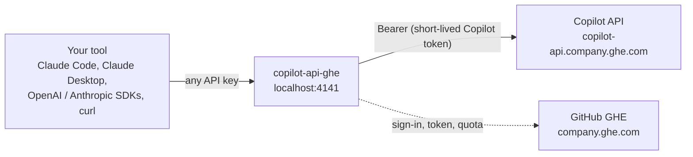

# ⚡ copilot-api-ghe

> ⚠️ You need an active GitHub Copilot license on the GitHub host you sign in to (`github.com`, a `*.ghe.com` tenant or GitHub Enterprise Server).

Use GitHub Copilot from any tool that speaks the **OpenAI** or **Anthropic** API, including [Claude Code](https://docs.anthropic.com/en/docs/claude-code/overview) and Claude Desktop. 🚀

## ✨ What it does

- 🔌 **OpenAI and Anthropic compatible** API in front of Copilot: chat completions, messages, responses, decisions, embeddings and models.
- 🎯 **Routes by model.** Each model declares the Copilot endpoints it supports. Claude goes to `/v1/messages` and GPT-5/6 goes to `/responses`, both as native passthrough. Other models fall back to translation.
- 🖥️ **Web dashboard** with quota, a searchable model list, an API reference with a **Try it** button, client setup guides, and docs with diagrams.
- 📜 **OpenAPI spec** of the proxy at `/openapi.yaml`.
- 🐳 **Docker image** with token persistence.

## 🧭 How it works



You sign in to GitHub once. The proxy turns that into short-lived Copilot tokens, refreshes them for you, and sends each request to the Copilot endpoint that matches the model. More diagrams are in [docs/architecture.md](docs/architecture.md).

## 🚀 Quick start

Requires [Node.js](https://nodejs.org/) v18 or later.

```sh
git clone https://<host>/<org>/copilot-api-ghe.git
cd copilot-api-ghe
npm install
npm run build
node dist/main.js start
```

On first run it prints a code and a URL (for example `https://company.ghe.com/login/device`). Choose the host with `-h`/`--host`, e.g. `start -h company.ghe.com`; the default is `github.com`. Open it, enter the code and approve. The proxy then listens on `http://localhost:4141`.

- Dashboard: `http://localhost:4141/dashboard`
- Models: `curl http://localhost:4141/v1/models`
- Any API key works, for example `dummy`.

## 🔀 Which endpoint for which model

| Models | Call |
| --- | --- |
| Claude | `POST /v1/messages` (native passthrough) |
| GPT-5 / GPT-6, Grok, Mai | `POST /v1/responses` (native passthrough) |
| Gemini, Kimi, Azure OpenAI (`gpt-4o`, `gpt-4.1`, ...) | `POST /v1/chat/completions` (`/v1/messages` is translated) |
| `gpt-6-luna` | `POST /v1/decisions` (typed predicate, choice and score answers) |
| `text-embedding-*` | `POST /v1/embeddings` |

The list is fetched from Copilot at startup, so it always matches your account. Open the dashboard **Models** tab or call `GET /v1/models` (each model includes `supported_endpoints`). Details: [docs/models-and-routing.md](docs/models-and-routing.md).

## 🔌 Connect your tools

The dashboard **Connect Clients** tab generates all of these with your real URL and the newest Claude models. Full guide: [docs/clients.md](docs/clients.md).

**Claude Code.** Let the proxy build the command:

```sh
node dist/main.js start --claude-code
```

or add this to `.claude/settings.json`:

```json
{
  "env": {
    "ANTHROPIC_BASE_URL": "http://localhost:4141",
    "ANTHROPIC_AUTH_TOKEN": "dummy",
    "ANTHROPIC_MODEL": "claude-opus-5.5",
    "ANTHROPIC_DEFAULT_SONNET_MODEL": "claude-sonnet-5.5",
    "ANTHROPIC_DEFAULT_OPUS_MODEL": "claude-opus-5.5",
    "ANTHROPIC_DEFAULT_HAIKU_MODEL": "claude-haiku-5.5",
    "DISABLE_NON_ESSENTIAL_MODEL_CALLS": "1",
    "CLAUDE_CODE_DISABLE_NONESSENTIAL_TRAFFIC": "1"
  },
  "permissions": { "deny": ["WebSearch"] }
}
```

**Claude Desktop.** Enable Developer Mode, open **Configure Third-Party Inference**, choose **Gateway** and enter `http://localhost:4141` (no trailing slash, no `/v1`) with any API key. Steps and caveats: [docs/clients.md](docs/clients.md#claude-desktop).

**OpenAI and Anthropic SDKs, Cursor, Continue, Aider:**

```sh
export OPENAI_BASE_URL=http://localhost:4141/v1
export OPENAI_API_KEY=dummy
export ANTHROPIC_BASE_URL=http://localhost:4141
export ANTHROPIC_AUTH_TOKEN=dummy
```

```python
from openai import OpenAI

client = OpenAI(base_url="http://localhost:4141/v1", api_key="dummy")
reply = client.chat.completions.create(
    model="gpt-4o",
    messages=[{"role": "user", "content": "Hello"}],
)
print(reply.choices[0].message.content)
```

## 🖥️ Dashboard

Open `/dashboard`. It has five tabs:

| Tab | What you get |
| --- | --- |
| **Overview** | Quota and reset date, account, and an "which endpoint should I use?" cheat sheet |
| **Models** | Search and filters, grouped by endpoint, with limits and capabilities per model |
| **API Reference** | Every endpoint with an editable request, a live curl, and a **Send** button |
| **Connect Clients** | Setup for Claude Code, Claude Desktop and the SDKs |
| **Docs & Troubleshooting** | Diagrams, routing rules, endpoint quirks and an error table |

> 💸 **Send makes a real request and uses Copilot credits.** The default payloads are tiny.

## 🐳 Docker

```sh
docker build -t copilot-api .

# first time: sign in (the token is saved to the mounted folder)
docker run -it --rm -v "$PWD/copilot-data:/root/.local/share/copilot-api" copilot-api --auth

# run
docker run -d --name copilot-api -p 4141:4141 \
  -v "$PWD/copilot-data:/root/.local/share/copilot-api" copilot-api
```

- Extra arguments go to `start`, for example `... copilot-api --rate-limit 2 --wait`.
- To update, rebuild the image, remove the old container and run it again with the same volume. You stay signed in.
- `copilot-data/` holds your GitHub token. It is git-ignored and docker-ignored: never commit it or bake it into an image.

## ⚙️ Configuration

Commands: `start`, `auth`, `check-usage`, `debug`. Flags for `start`:

| Flag | Default | Purpose |
| --- | --- | --- |
| `-p, --port` | `4141` | Port to listen on |
| `-v, --verbose` | off | Debug logging (logs request payloads) |
| `-a, --account-type` | `individual` | `individual`, `business` or `enterprise` (only a fallback; GHE returns the API URL itself) |
| `--manual` | off | Approve each request in the terminal |
| `-r, --rate-limit` | none | Minimum seconds between requests |
| `-w, --wait` | off | Wait instead of failing when the rate limit is hit |
| `-g, --github-token` | token file | Use this GitHub token instead of the saved one |
| `-c, --claude-code` | off | Pick models and copy a ready-to-run Claude Code command |
| `--show-token` | off | Print tokens, and enable `GET /token` |
| `--proxy-env` | off | Use `HTTP_PROXY`, `HTTPS_PROXY` and `NO_PROXY` from the environment |

More in [docs/operations.md](docs/operations.md).

## 📚 Documentation

Everything is in [`docs/`](docs/README.md):

| Doc | Covers |
| --- | --- |
| [architecture.md](docs/architecture.md) | Components, auth chain, request flows, diagrams |
| [endpoints.md](docs/endpoints.md) | Every endpoint with examples and quirks |
| [models-and-routing.md](docs/models-and-routing.md) | How models map to Copilot endpoints |
| [clients.md](docs/clients.md) | Claude Code, Claude Desktop, SDKs |
| [operations.md](docs/operations.md) | Install, flags, Docker, tokens, security |
| [troubleshooting.md](docs/troubleshooting.md) | Errors, causes and fixes |
| [openapi.yaml](docs/openapi.yaml) | OpenAPI spec of the proxy (also served at `/openapi.yaml`) |
| [upstream-copilot-api.openapi.yaml](docs/upstream-copilot-api.openapi.yaml) | Reverse-engineered upstream Copilot API |

## 🩺 Troubleshooting

| You see | Do this |
| --- | --- |
| `Model X does not support /chat/completions. Supported endpoints: ...` | Call the endpoint named in the message (GPT-5/6 and Grok: `/v1/responses`, Claude: `/v1/messages`) |
| Empty text and `stop_reason: max_tokens` | Reasoning models (Gemini) used the whole budget: raise `max_tokens` |
| 401, or "Failed to get Copilot token" | Sign in again: `node dist/main.js auth` (Docker: `... copilot-api --auth`) |
| A new model is missing | The list is cached at startup: restart the proxy |
| Claude Desktop model list is empty | Use the bare origin as the gateway URL, or add `inferenceModels` ([docs/clients.md](docs/clients.md#claude-desktop)) |

The full table is in [docs/troubleshooting.md](docs/troubleshooting.md).

## 🔒 Security

- 🚨 **The proxy does not authenticate callers.** Any API key is accepted, so anyone who can reach the port can spend your Copilot credits. Keep it on localhost or behind a network control. Do not expose it publicly.
- `GET /token` returns 403 unless you start with `--show-token`.
- Your GitHub token lives in `~/.local/share/copilot-api/github_token.<host>` (mode 600), or in the mounted Docker volume.
- Prompts and responses are not logged unless you pass `--verbose`.

## 🚧 Known limitations

- The Copilot endpoints are undocumented, found by inspecting VS Code's Copilot extension, and may change without notice.
- Claude Desktop may require HTTPS for the gateway URL (not verified). Cowork and Remote Control are not covered.
- Not supported: WebSocket `/responses`. Not yet tested: image or JSON input for `/v1/decisions`, and forwarding of `anthropic-beta` headers with real Claude Code sessions.

## 🛠️ Development

```sh
npm run build       # bundle to dist/
npm run typecheck   # tsc --noEmit
npm run lint        # eslint
npm run docs:sync   # regenerate src/routes/openapi/spec.ts from docs/openapi.yaml
npm run docs:check  # fail if routes, flags or the generated spec are undocumented
```

The docs are part of the code. When you change a route, a flag, routing or an error message, update `docs/` and the dashboard in the same change, then run `npm run docs:sync` and `npm run docs:check`. The change-to-doc table is in [docs/README.md](docs/README.md).

## 📄 License

[MIT](LICENSE)
