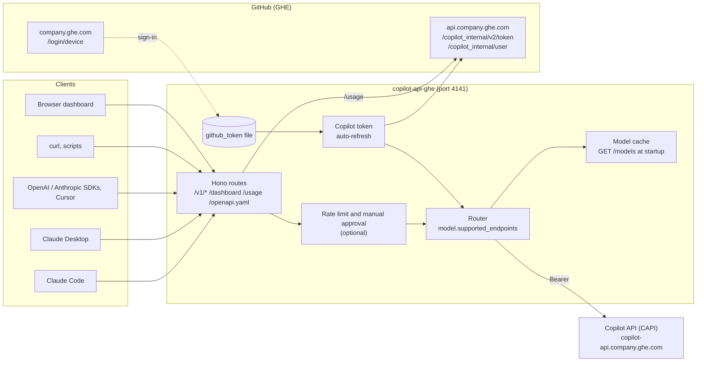
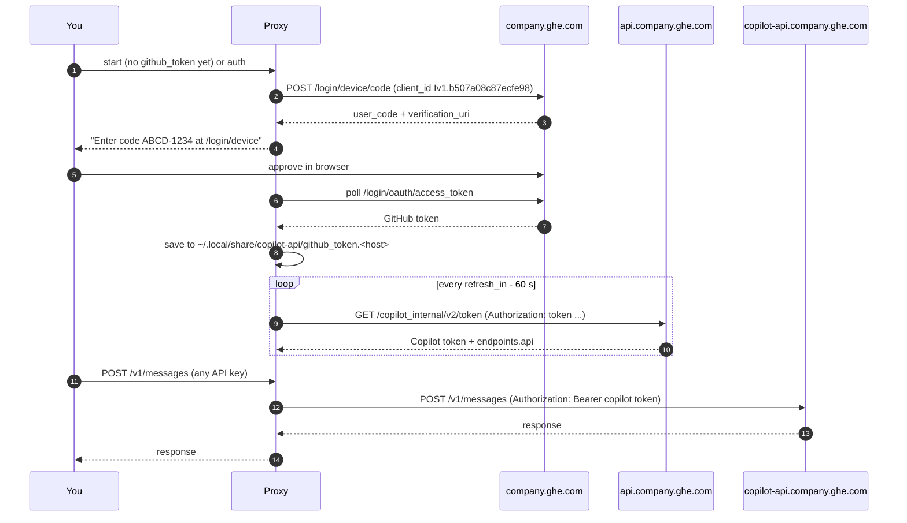
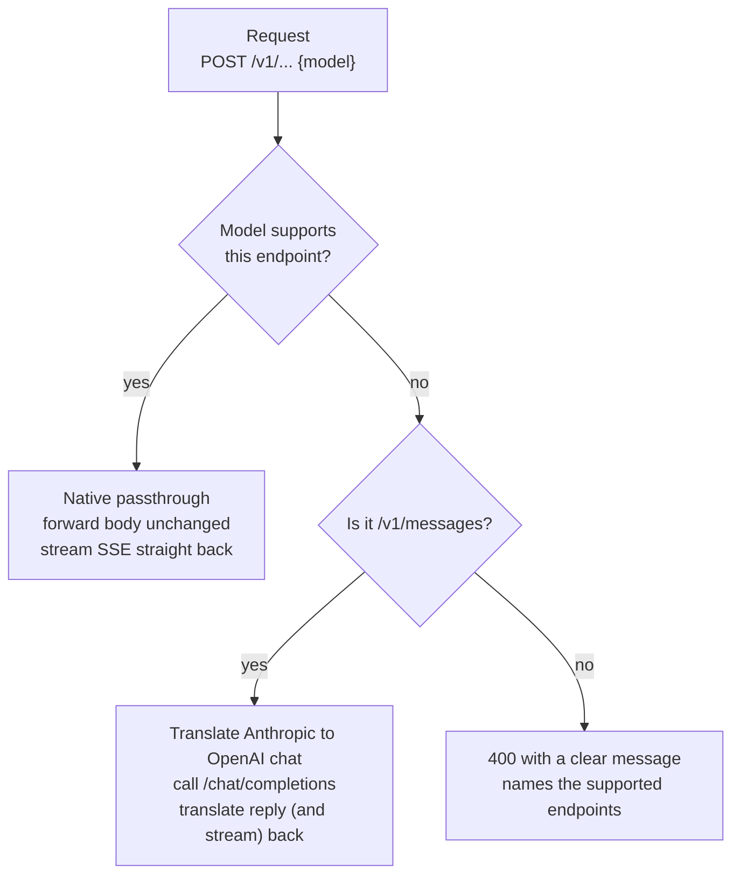
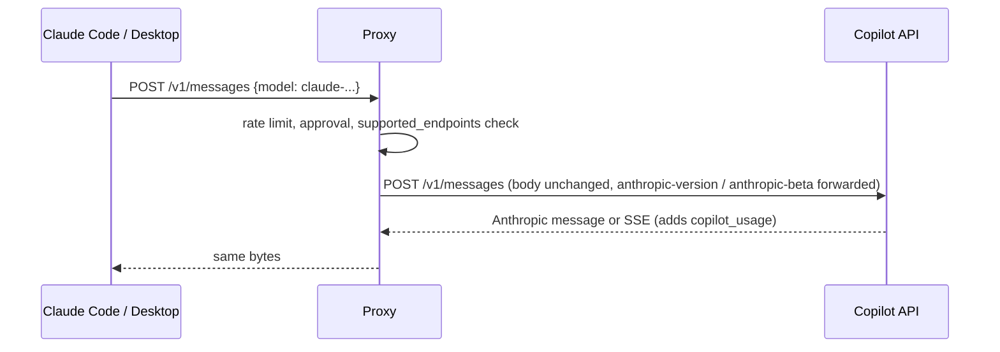
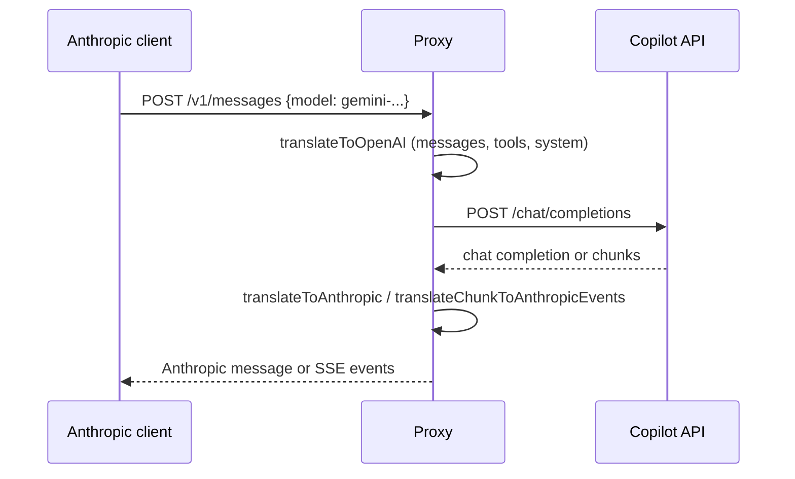
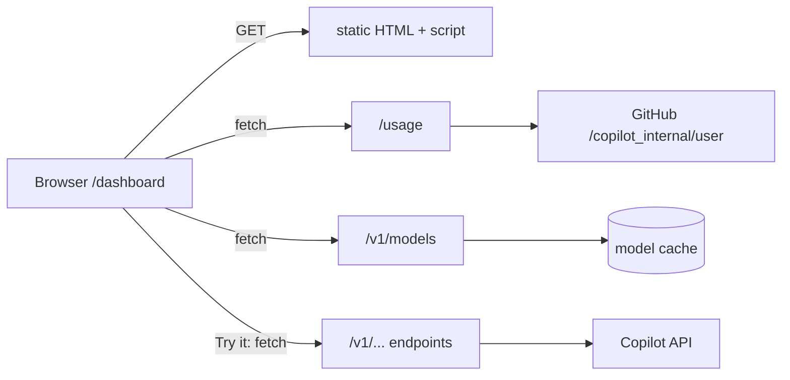

# Architecture

The proxy is a small [Hono](https://hono.dev) server (`src/server.ts`) that makes GitHub Copilot look like the OpenAI and Anthropic APIs.

## Components

| Part | Where | Purpose |
| --- | --- | --- |
| Routes | `src/server.ts`, `src/routes/*` | One module per endpoint family |
| Guard | `src/lib/rate-limit.ts`, `src/lib/approval.ts` | `--rate-limit`, `--wait`, `--manual` |
| Router | `src/services/copilot/passthrough.ts` | `modelSupportsEndpoint`, `forwardToCopilot`, `unsupportedEndpointHint` |
| Translation | `src/routes/messages/*` | Anthropic to OpenAI and back (fallback only) |
| Model cache | `src/lib/utils.ts` (`cacheModels`), `src/services/copilot/get-models.ts` | Loaded at startup, used for routing |
| Tokens | `src/lib/token.ts`, `src/services/github/*` | Device sign-in, Copilot token exchange and refresh |
| Dashboard | `src/routes/dashboard.ts`, `src/routes/dashboard/*` | Static page; data from `/usage` and `/v1/models` |

## Authentication chain

- The GitHub token is long-lived and stored in the token file (a mounted volume in Docker).
- The Copilot token is short-lived. `setupCopilotToken` refreshes it on a timer. The upstream base URL comes from the token response (`endpoints.api`), which is why it works for `*.ghe.com`.
- Clients never see either token. The proxy does **not** authenticate its own callers.

## Request flow: routing

Details and the full model table are in [models-and-routing.md](models-and-routing.md).

## Request flow: Claude via /v1/messages

## Request flow: non-Claude via /v1/messages (translated)

## Dashboard data flow

The page refreshes usage and models every 60 seconds. **Try it** sends real requests through the proxy and spends credits.
